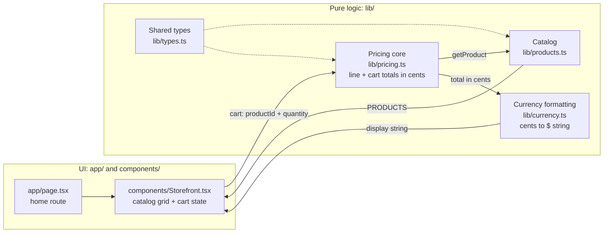
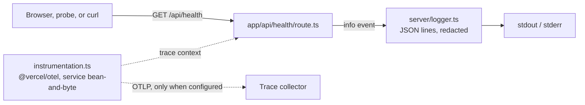

# Architecture

Bean & Byte is a single Next.js 14 (App Router) application. It has no
database and calls no external APIs: the catalog is a static list in code,
the cart lives in React state in the browser, and every price comes from a
pure TypeScript pricing core.

## Catalog to rendered price

1. **Catalog.** `lib/products.ts` exports `PRODUCTS` and `getProduct`.
   `Storefront` renders one card per product.
2. **Cart.** `Storefront` keeps the cart as `CartItem[]` (product id and
   quantity) in `useState`. "Add to cart" and the +/− buttons only change
   quantities; they never compute money.
3. **Pricing core.** `calculateLineTotal` and `calculateCartTotal` in
   `lib/pricing.ts` turn quantities into integer cents. A line of 3 or more
   of one item is 10% off, rounded to the nearest cent.
4. **Currency formatting.** `formatCurrency` in `lib/currency.ts` is the only
   place cents become a display string such as `$9.45`.

## Where code lives

| Directory | Contains | Rules |
| --- | --- | --- |
| `app/` | Routes: the home page, the root layout, and `app/api/health/route.ts` | UI and HTTP only; no pricing math |
| `components/` | React components (`Storefront`) | Calls into `lib/` for every price |
| `lib/` | Pricing, catalog, currency, types | Pure TypeScript: no React, no I/O, integer cents |
| `server/` | Server-only helpers such as the JSON logger | May do I/O; never imported by client components |
| `tests/` | Vitest unit tests | Mirror the module they cover |
| `e2e/` | Playwright browser tests | Drive the built app on port 3000 |

## Server-side pieces

- **Health check.** `GET /api/health` returns `{"status":"ok"}` with HTTP
  200 and is never cached (`dynamic = "force-dynamic"`). Probes, the
  Playwright suite, and the DAST workflow use it as the readiness signal.
- **Logging.** `server/logger.ts` writes one JSON object per line with
  `timestamp`, `level`, `message`, the active `traceId`/`spanId` when a span
  is recording, and the event fields. Values under keys that look sensitive
  (password, token, authorization, cookie, email, card, and similar) are
  replaced with `[REDACTED]` at any depth. `LOG_LEVEL` sets the minimum
  level (default `info`).
- **Tracing.** `instrumentation.ts` registers OpenTelemetry through
  `@vercel/otel` with the service name `bean-and-byte`. Spans are exported
  only when an exporter is configured, for example with
  `OTEL_EXPORTER_OTLP_ENDPOINT`; no external service is needed to run the
  app.

## External dependencies

None at runtime. The app needs no environment variables, credentials, or
services. CI uses GitHub Actions only.
