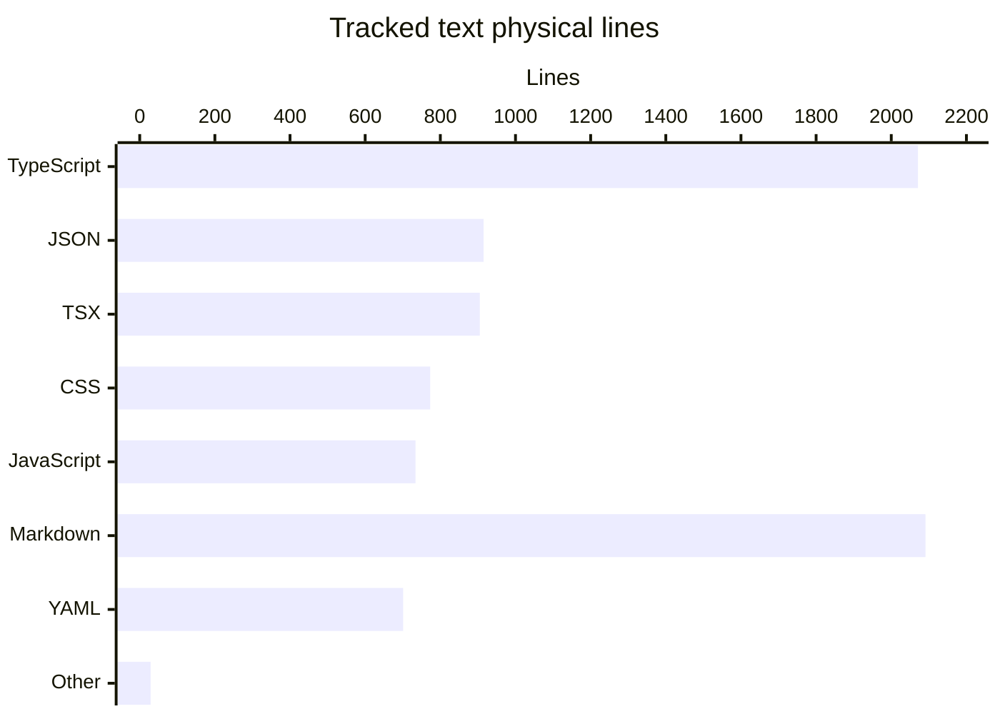

# By the numbers

Data collected on **2026-11-16**, beginning at **21:52:39 UTC**, at `937df252d4082ae269fca4547f08d40854d9bcb7` (`HEAD` and local `origin/main`, the default branch). These are repository measurements, not production usage or individual performance statistics. See [Architecture](overview/architecture.md) for the boundaries and [Lore](lore.md) for the changes behind them.

All measurements were rerun, including source/test counts, directory sizes, import depth, and exports after SAVE10 changed the application and tests. Inventory and text measurements use current committed Git blobs, not concurrent worktree wiki edits; activity uses reachable default-branch metadata and numeric diffs only. The committed wiki totals therefore describe the page versions at this revision, not this refreshed page or other uncommitted documentation.

## Inventory and counting rules

`git ls-tree -r -z --name-only origin/main` lists **140 tracked files**. Excluding the generated `package-lock.json` and `next-env.d.ts` leaves **138**:

| Category | Files | Scope |
| --- | ---: | --- |
| Source | 41 | Everything in `app/`, `components/`, `lib/`, `server/`, `scripts/`, plus `instrumentation.ts`; includes CSS |
| Tests | 8 | Seven files in `tests/`, one in `e2e/` |
| Configuration and automation | 35 | Remaining non-Markdown, non-asset files: root tool configs, `.github/` workflows/settings, `.devcontainer/devcontainer.json`, `.husky/pre-commit`, `.env.example`, and `observability/grafana/` JSON |
| Handwritten documentation | 9 | Non-wiki Markdown, including issue/PR templates, `AGENTS.md`, and `.factory/skills/storefront-qa/SKILL.md` |
| Committed wiki documentation | 31 | Markdown pages in `droid-wiki/`, counted separately from handwritten documentation |
| Wiki metadata | 1 | `droid-wiki/.wiki-meta.json`, separate from the 35 configuration/automation files above |
| Assets | 13 | JPEGs in `public/products/` |
| **Total** | **138** | Mutually exclusive categories |

The measurement includes the committed wiki but excludes uncommitted wiki edits, installed dependencies, build output, coverage, generated API documentation, reports, Playwright artifacts, and TypeScript build caches. Current revision blobs, not dirty worktree content, supply text totals; no historical implementation blobs were read. None of the excluded artifact directories contributes committed files at this revision. Environment-file contents were not read; `.env.example` is counted by path only in the inventory and excluded from language and churn totals.

There are **40 source modules**: each `.ts`, `.tsx`, or `.mjs` file in the source scope above counts once. This is a file-level metric, not 40 packages or deployable services. The repository has one application package, not a monorepo. The remaining source file is `app/globals.css`; root executable configuration files and tests are not source modules here.

## Language lines

Physical lines include blank lines and comments. A newline terminates one line; a nonempty final unterminated line counts once, and a trailing newline does not create an extra line. This is not executable SLOC, coverage, or a complexity score.

The table covers all retained text except environment files: **124 files, 8,219 lines**. It includes tests, documentation, and configuration, not just application code. Markdown comprises **590 handwritten-documentation lines** and **1,501 committed-wiki lines**; wiki metadata adds **57 JSON lines**. Excluding the committed wiki and its metadata leaves **6,661 lines**. `.prettierrc` is classified as JSON; extensionless ignore/ownership/hook files are “Other text.”

| Language | Files | Physical lines |
| --- | ---: | ---: |
| TypeScript (`.ts`) | 27 | 2,071 |
| JSON | 12 | 915 |
| TSX (`.tsx`) | 16 | 905 |
| CSS | 1 | 773 |
| JavaScript (`.mjs`) | 9 | 734 |
| Markdown | 40 | 2,091 |
| YAML | 15 | 701 |
| Other text | 4 | 29 |



The source category has **3,492 physical lines**; tests have **899**. This does not claim every source module has a corresponding test. See [Testing](how-to-contribute/testing.md) for the actual test boundaries.

## Average source-file sizes

Arithmetic means use UTF-8 bytes and the same physical-line definition, grouped by top-level source directory. Nested `scripts/lib/github-issues.mjs` belongs to `scripts/`. Binary assets and tests are outside this table.

| Source location | Files | Total bytes | Mean bytes/file | Total lines | Mean lines/file |
| --- | ---: | ---: | ---: | ---: | ---: |
| `app/` | 9 | 17,135 | 1,903.9 | 971 | 107.9 |
| `components/` | 12 | 25,033 | 2,086.1 | 884 | 73.7 |
| `lib/` | 8 | 16,315 | 2,039.4 | 593 | 74.1 |
| `scripts/` | 7 | 20,934 | 2,990.6 | 686 | 98.0 |
| `server/` | 4 | 10,555 | 2,638.8 | 341 | 85.3 |
| Root: `instrumentation.ts` | 1 | 575 | 575.0 | 17 | 17.0 |

`app/globals.css` contributes 773 of `app/`'s 971 lines, so that average should not be interpreted as the typical route-handler size.

## Recent Git activity

Counts use commits reachable from local `origin/main`, including merges, with **committer dates in America/New_York** and calendar windows ending on November 16. Weekly rows are consecutive seven-day windows ending on the measurement date, not ISO weeks. No remote fetch was performed for this measurement. November and its final day are partial: only commits already reachable at collection time count. There is no history before November 1 in this reachable graph.

| Weekly window, inclusive | Commits |
| --- | ---: |
| 2026-10-20–2026-10-26 | 0 |
| 2026-10-27–2026-11-02 | 6 |
| 2026-11-03–2026-11-09 | 20 |
| 2026-11-10–2026-11-16 | 10 |

| Calendar month | Commits |
| --- | ---: |
| September 2026 | 0 |
| October 2026 | 0 |
| November 2026, through November 16 | 36 |

### Ninety-day churn

The inclusive window is **2026-08-19–2026-11-16**, using America/New_York dates and the collection-time cutoff above. Select commits by their committer timestamp converted to that timezone, then sum numeric additions/deletions from each non-merge commit using `git diff-tree --root --no-commit-id --numstat -r --no-renames -z <commit>`. Retain historical paths even if later deleted, with the same generated-file exclusions as the inventory, and additionally exclude environment-file paths so `.env.example` remains an inventory-only count. This environment exclusion is stricter than the previous snapshot's churn scope. All 31 reachable non-merge commits fall inside the window. Root-commit additions count; merge commits do not, avoiding double-counting their branch patches. Binary entries have no numeric line count. Environment contents and historical patch bodies are never read; history contributes only numeric change counts.

| Scope | Added lines | Deleted lines | Churn: added + deleted |
| --- | ---: | ---: | ---: |
| Retained repository text | 9,514 | 1,295 | 10,809 |
| Source subset | 4,034 | 542 | 4,576 |
| Test subset | 1,054 | 155 | 1,209 |
| Committed wiki and metadata subset | 1,584 | 26 | 1,610 |

There are also **13 binary file-change entries**, excluded from line churn. The five largest file hotspots are:

| File, repository-root path | Added | Deleted | Churn |
| --- | ---: | ---: | ---: |
| `app/globals.css` | 838 | 65 | 903 |
| `observability/grafana/dashboard.json` | 522 | 0 | 522 |
| `tests/logger.test.ts` | 283 | 131 | 414 |
| `server/logger.ts` | 243 | 96 | 339 |
| `docs/architecture.md` | 213 | 80 | 293 |

The five largest directory hotspots aggregate all retained historical paths recursively by their top-level directory:

| Directory, repository-root path | Added | Deleted | Churn |
| --- | ---: | ---: | ---: |
| `droid-wiki/` | 1,584 | 26 | 1,610 |
| `.github/` | 1,027 | 259 | 1,286 |
| `scripts/` | 927 | 241 | 1,168 |
| `app/` | 1,045 | 74 | 1,119 |
| `components/` | 986 | 102 | 1,088 |

Churn measures edits, including formatting and initial creation, not effort or defect risk. The committed wiki is the largest directory hotspot; it does not indicate application growth. Across the window, `.github/workflows/droid-wiki-refresh.yml` contributes 141 additions and no deletions.

### Explicit bot attribution: a lower bound

**21 of 36 commits (58.3%)** have explicit bot attribution: two have a `[bot]` author identity and 19 additional commits have a `Co-authored-by:` trailer containing `[bot]`. A commit matching both would count only once. Match author name/email and case-insensitive trailer lines in the full commit message; use the same reachable graph and 90-day date window as above, including merges.

This is a **lower bound on bot-associated commits**, not a measure of generated lines or autonomous work. A human-authored commit can carry bot coauthorship; unmarked automation is not inferred from wording, and the GitHub committer identity alone is not treated as a bot. No personal rankings are calculated.

## Internal import depth

Rescanning the current 40 source modules and exhaustively enumerating simple paths finds a maximum of **9 import edges across 10 source modules**:

```text
app/page.tsx
  → components/Storefront.tsx
  → components/ProductCard.tsx
  → components/CartProvider.tsx
  → components/posthog.ts
  → lib/analytics.ts
  → lib/orders.ts
  → lib/pricing.ts
  → lib/products.ts
  → lib/types.ts
```

Method: scan literal relative imports, including `import type` and literal dynamic `import()`, resolve exact paths or `.ts`/`.tsx`/`.mjs` and index variants against the 40 source modules, then enumerate directed paths without repeating a module. External packages, CSS, tests, and config files are excluded. Ties may exist; this is one maximum-length path. It includes type-only edges (for example `lib/analytics.ts` → `lib/orders.ts` and `lib/products.ts` → `lib/types.ts`), so it is **not** a runtime call stack or bundle-loading depth.

## Exported symbols per module

Metric: count each top-level exported declaration name once, including types and constants; count a default export as one exported binding. Do not count object members or local helpers. A fresh scan of current source found direct declarations only: the scan matches line-start `export default`, `export [async] function`, `export const`, and exported type/interface/class/enum declarations. There are no re-export lists or destructured exported declarations needing expansion in this scope.

**98 exported bindings / 40 source modules = 2.45 per module.** Zero-export executable scripts remain in the denominator. These counts describe module surfaces, not an external public API.

| Module, repository-root path | Exports |
| --- | ---: |
| `app/api/health/route.ts` | 2 |
| `app/api/orders/route.ts` | 2 |
| `app/checkout/page.tsx` | 2 |
| `app/error.tsx` | 1 |
| `app/global-error.tsx` | 1 |
| `app/layout.tsx` | 2 |
| `app/orders/[id]/page.tsx` | 2 |
| `app/page.tsx` | 1 |
| `components/Analytics.tsx` | 1 |
| `components/CartDrawer.tsx` | 1 |
| `components/CartProvider.tsx` | 2 |
| `components/Checkout.tsx` | 1 |
| `components/MenuAnnouncement.tsx` | 1 |
| `components/OrderConfirmation.tsx` | 1 |
| `components/OrderLines.tsx` | 1 |
| `components/ProductCard.tsx` | 1 |
| `components/SiteHeader.tsx` | 1 |
| `components/Storefront.tsx` | 1 |
| `components/lastOrder.ts` | 2 |
| `components/posthog.ts` | 4 |
| `instrumentation.ts` | 1 |
| `lib/analytics.ts` | 10 |
| `lib/cart.ts` | 4 |
| `lib/currency.ts` | 1 |
| `lib/orders.ts` | 11 |
| `lib/pricing.ts` | 5 |
| `lib/products.ts` | 4 |
| `lib/promotions.ts` | 3 |
| `lib/types.ts` | 6 |
| `scripts/check-agents-md.mjs` | 0 |
| `scripts/ci-test-summary.mjs` | 0 |
| `scripts/grafana-alert-issues.mjs` | 0 |
| `scripts/grafana-sync.mjs` | 0 |
| `scripts/lib/github-issues.mjs` | 3 |
| `scripts/posthog-error-issues.mjs` | 0 |
| `scripts/todo-report.mjs` | 0 |
| `server/instrumentation-node.ts` | 1 |
| `server/logger.ts` | 10 |
| `server/release.ts` | 2 |
| `server/telemetry.ts` | 7 |

To refresh, use `git ls-tree -r -z origin/main` for current tracked paths and blob IDs, apply the exclusions and categories above, and pass only current-revision non-environment text blob IDs to `git cat-file blob <blob-id>`. Count physical lines without printing file bodies. Do not read historical implementation blobs or patches. Rerun source/test, size, export, and import measurements against that current tree. Use `git log origin/main --format='%H %ct %P'` for commit hashes, committer timestamps, and parent counts; convert timestamps before selecting calendar windows. Inspect full commit messages for bot trailers without publishing author emails, and use the numeric-only `git diff-tree` command above for non-merge churn. Recheck paths and export syntax if the tree changes.
