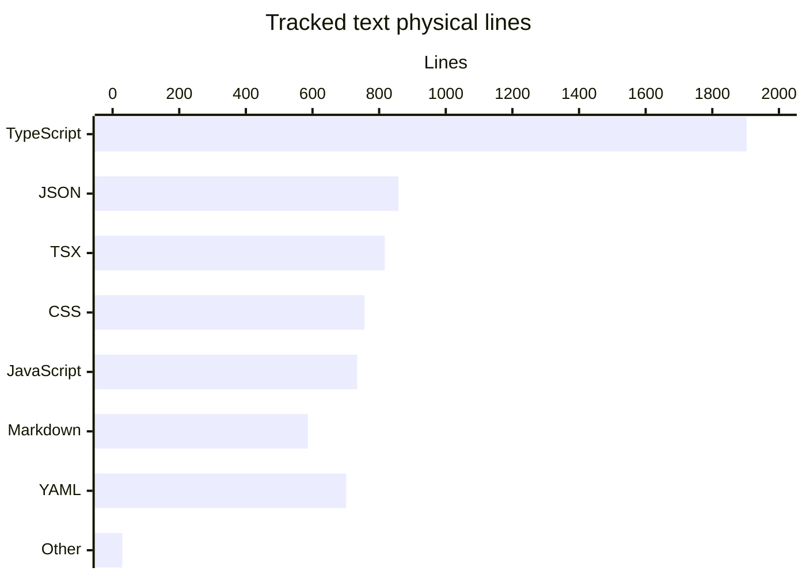

# By the numbers

Measured **2026-11-12**, at `838675d3faf02f07fbc7a486afc232041f2641ed` (`HEAD` and `origin/main`). These are repository measurements, not production usage or individual performance statistics. See [Architecture](overview/architecture.md) for the boundaries and [Lore](lore.md) for the changes behind them.

All measurements were independently recomputed from tracked Git blobs and the reachable default-branch history. Since the previous snapshot at `fbdb7e05a7cf73f95ac71eda3ab960ef47be3208`, the sole tree change is 18 added YAML lines in `.github/workflows/droid-wiki-refresh.yml`, with no deletions. The workflow now ignores wiki-only pushes and requests squash auto-merge subject to branch protections. Source/test counts, directory sizes, import depth, and exports were rechecked and are unchanged.

## Inventory and counting rules

`git ls-tree -r -z --name-only origin/main` lists **108 tracked files**. Excluding the generated `package-lock.json` and `next-env.d.ts` leaves **106**:

| Category | Files | Scope |
| --- | ---: | --- |
| Source | 41 | Everything in `app/`, `components/`, `lib/`, `server/`, `scripts/`, plus `instrumentation.ts`; includes CSS |
| Tests | 8 | Seven files in `tests/`, one in `e2e/` |
| Configuration and automation | 35 | Remaining non-Markdown, non-asset files: root tool configs, `.github/` workflows/settings, `.devcontainer/devcontainer.json`, `.husky/pre-commit`, `.env.example`, and `observability/grafana/` JSON |
| Documentation | 9 | Tracked Markdown, including issue/PR templates, `AGENTS.md`, and `.factory/skills/storefront-qa/SKILL.md` |
| Assets | 13 | JPEGs in `public/products/` |
| **Total** | **106** | Mutually exclusive categories |

The measurement excludes this uncommitted wiki, installed dependencies, build output, coverage, generated API documentation, reports, Playwright artifacts, and TypeScript build caches. None of those artifact directories contributes committed files at this revision. Environment-file contents were not read; `.env.example` is counted by path only.

There are **40 source modules**: each `.ts`, `.tsx`, or `.mjs` file in the source scope above counts once. This is a file-level metric, not 40 packages or deployable services. The remaining source file is `app/globals.css`; root executable configuration files and tests are not source modules here.

## Language lines

Physical lines include blank lines and comments. A newline terminates one line; a nonempty final unterminated line counts once, and a trailing newline does not create an extra line. This is not executable SLOC, coverage, or a complexity score.

The table covers all retained text except environment files: **92 files, 6,384 lines**. It includes tests, documentation, and configuration, not just application code. `.prettierrc` is classified as JSON; extensionless ignore/ownership/hook files are “Other text.”

| Language | Files | Physical lines |
| --- | ---: | ---: |
| TypeScript (`.ts`) | 27 | 1,903 |
| JSON | 11 | 858 |
| TSX (`.tsx`) | 16 | 817 |
| CSS | 1 | 756 |
| JavaScript (`.mjs`) | 9 | 734 |
| Markdown | 9 | 586 |
| YAML | 15 | 701 |
| Other text | 4 | 29 |



The source category has **3,342 physical lines**; tests have **776**. This does not claim every source module has a corresponding test. See [Testing](how-to-contribute/testing.md) for the actual test boundaries.

## Average source-file sizes

Arithmetic means use UTF-8 bytes and the same physical-line definition, grouped by top-level source directory. Nested `scripts/lib/github-issues.mjs` belongs to `scripts/`. Binary assets and tests are outside this table.

| Source location | Files | Total bytes | Mean bytes/file | Total lines | Mean lines/file |
| --- | ---: | ---: | ---: | ---: | ---: |
| `app/` | 9 | 16,919 | 1,879.9 | 954 | 106.0 |
| `components/` | 12 | 22,890 | 1,907.5 | 796 | 66.3 |
| `lib/` | 8 | 14,977 | 1,872.1 | 548 | 68.5 |
| `scripts/` | 7 | 20,934 | 2,990.6 | 686 | 98.0 |
| `server/` | 4 | 10,555 | 2,638.8 | 341 | 85.3 |
| Root: `instrumentation.ts` | 1 | 575 | 575.0 | 17 | 17.0 |

`app/globals.css` contributes 756 of `app/`'s 954 lines, so that average should not be interpreted as the typical route-handler size.

## Recent Git activity

Counts use commits reachable from local `origin/main`, including merges, with **committer dates in America/New_York** and calendar windows ending on November 12. No remote fetch was performed. November is partial; there is no history before November 1 in this reachable graph.

| Weekly window, inclusive | Commits |
| --- | ---: |
| 2026-10-16–2026-10-22 | 0 |
| 2026-10-23–2026-10-29 | 0 |
| 2026-10-30–2026-11-05 | 6 |
| 2026-11-06–2026-11-12 | 26 |

| Calendar month | Commits |
| --- | ---: |
| September 2026 | 0 |
| October 2026 | 0 |
| November 2026, through November 12 | 32 |

### Ninety-day churn

The inclusive window is **2026-08-15–2026-11-12**. Select commits by their committer timestamp converted to America/New_York, then sum numeric additions/deletions from each non-merge commit's `git show --format= --numstat` (equivalent to the selected `git log origin/main --no-merges --numstat` entries). Retain historical paths even if later deleted, with the same generated-file exclusions as the inventory. All 27 reachable non-merge commits fall inside the window. Root-commit additions count; merge commits do not, avoiding double-counting their branch patches. Binary entries have no numeric line count. Environment contents are never read; history contributes only numeric change counts.

| Scope | Added lines | Deleted lines | Churn: added + deleted |
| --- | ---: | ---: | ---: |
| Retained repository text | 7,666 | 1,258 | 8,924 |
| Source subset | 3,868 | 526 | 4,394 |
| Test subset | 931 | 155 | 1,086 |

There are also **13 binary file-change entries**, excluded from line churn. The five largest file hotspots are:

| File, repository-root path | Added | Deleted | Churn |
| --- | ---: | ---: | ---: |
| `app/globals.css` | 821 | 65 | 886 |
| `observability/grafana/dashboard.json` | 522 | 0 | 522 |
| `tests/logger.test.ts` | 283 | 131 | 414 |
| `server/logger.ts` | 243 | 96 | 339 |
| `docs/architecture.md` | 213 | 80 | 293 |

The five largest directory hotspots aggregate all retained historical paths recursively by their top-level directory:

| Directory, repository-root path | Added | Deleted | Churn |
| --- | ---: | ---: | ---: |
| `.github/` | 1,027 | 259 | 1,286 |
| `scripts/` | 927 | 241 | 1,168 |
| `app/` | 1,028 | 74 | 1,102 |
| `components/` | 888 | 92 | 980 |
| `tests/` | 788 | 142 | 930 |

Churn measures edits, including formatting and initial creation, not effort or defect risk. Across the window, `.github/workflows/droid-wiki-refresh.yml` contributes 141 additions and no deletions; 18 additions are since the previous snapshot.

### Explicit bot attribution: a lower bound

**19 of 32 commits (59.4%)** have explicit bot attribution: two have a `[bot]` author identity and 17 additional commits have a `Co-authored-by:` trailer containing `[bot]`. A commit matching both would count only once. Match author name/email and case-insensitive trailer lines in the full commit message; use the same reachable graph and 90-day date window as above, including merges.

This is a **lower bound on bot-associated commits**, not a measure of generated lines or autonomous work. A human-authored commit can carry bot coauthorship; unmarked automation is not inferred from wording, and the GitHub committer identity alone is not treated as a bot. No personal rankings are calculated.

## Internal import depth

The longest discovered simple path has **9 import edges across 10 source modules**:

```text
app/page.tsx
  → components/Storefront.tsx
  → components/ProductCard.tsx
  → components/CartProvider.tsx
  → components/posthog.ts
  → lib/analytics.ts
  → lib/orders.ts
  → lib/pricing.ts
  → lib/products.ts
  → lib/types.ts
```

Method: scan literal relative imports, including `import type` and literal dynamic `import()`, resolve exact paths or `.ts`/`.tsx`/`.mjs` and index variants against the 40 source modules, then enumerate directed paths without repeating a module. External packages, CSS, tests, and config files are excluded. Ties may exist; this is one maximum-length path. It includes type-only edges (for example `lib/analytics.ts` → `lib/orders.ts` and `lib/products.ts` → `lib/types.ts`), so it is **not** a runtime call stack or bundle-loading depth.

## Exported symbols per module

Metric: count each top-level exported declaration name once, including types and constants; count a default export as one exported binding. Do not count object members or local helpers. Inspection of the current source found direct declarations only: the scan matches line-start `export default`, `export [async] function`, `export const`, and exported type/interface/class/enum declarations. There are no re-export lists or destructured exported declarations needing expansion in this scope.

**98 exported bindings / 40 source modules = 2.45 per module.** Zero-export executable scripts remain in the denominator. These counts describe module surfaces, not an external public API.

| Module, repository-root path | Exports |
| --- | ---: |
| `app/api/health/route.ts` | 2 |
| `app/api/orders/route.ts` | 2 |
| `app/checkout/page.tsx` | 2 |
| `app/error.tsx` | 1 |
| `app/global-error.tsx` | 1 |
| `app/layout.tsx` | 2 |
| `app/orders/[id]/page.tsx` | 2 |
| `app/page.tsx` | 1 |
| `components/Analytics.tsx` | 1 |
| `components/CartDrawer.tsx` | 1 |
| `components/CartProvider.tsx` | 2 |
| `components/Checkout.tsx` | 1 |
| `components/MenuAnnouncement.tsx` | 1 |
| `components/OrderConfirmation.tsx` | 1 |
| `components/OrderLines.tsx` | 1 |
| `components/ProductCard.tsx` | 1 |
| `components/SiteHeader.tsx` | 1 |
| `components/Storefront.tsx` | 1 |
| `components/lastOrder.ts` | 2 |
| `components/posthog.ts` | 4 |
| `instrumentation.ts` | 1 |
| `lib/analytics.ts` | 10 |
| `lib/cart.ts` | 4 |
| `lib/currency.ts` | 1 |
| `lib/orders.ts` | 11 |
| `lib/pricing.ts` | 5 |
| `lib/products.ts` | 4 |
| `lib/promotions.ts` | 3 |
| `lib/types.ts` | 6 |
| `scripts/check-agents-md.mjs` | 0 |
| `scripts/ci-test-summary.mjs` | 0 |
| `scripts/grafana-alert-issues.mjs` | 0 |
| `scripts/grafana-sync.mjs` | 0 |
| `scripts/lib/github-issues.mjs` | 3 |
| `scripts/posthog-error-issues.mjs` | 0 |
| `scripts/todo-report.mjs` | 0 |
| `server/instrumentation-node.ts` | 1 |
| `server/logger.ts` | 10 |
| `server/release.ts` | 2 |
| `server/telemetry.ts` | 7 |

To refresh, start from `git ls-tree -r -z --name-only origin/main`, apply the exclusions and categories above, and read retained non-environment blobs with `git show origin/main:<repository-root-path>`. Rerun the physical-line/export/import scans. Use `git log origin/main --format='%H %ct %P'` for commit hashes, committer timestamps, and parent counts; convert timestamps before selecting calendar windows. Inspect full commit messages for bot trailers and numeric non-merge diffs for churn. Recheck paths and export syntax if the tree changes.
