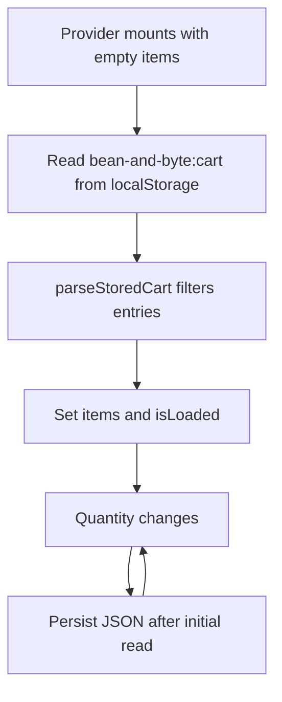

# Cart

Active contributors: nicolasschmidt2001 (Nicolas Schmidt)

## Purpose

The cart holds product ids and quantities across routes and saves them between visits. An applied promo code is shared across routes but is not restored after a reload. Prices are calculated from the current catalog rather than stored with quantities (`components/CartProvider.tsx`, `lib/cart.ts`, `lib/pricing.ts`).

## Layout and abstractions

`lib/cart.ts` provides immutable `addItem` and `changeQuantity` operations. Adding starts a line at one or increments the matching product; a quantity change removes lines that reach zero or below. `countItems` sums quantities, not distinct lines.

`components/CartProvider.tsx` exposes items, item count, loading status, drawer visibility, `promoCode`, and actions including `applyPromoCode` through `useCart`. Quantity actions use functional state updates. Calling `useCart` outside the provider throws. `app/layout.tsx` mounts the provider around the header, page content, and drawer.

`components/SiteHeader.tsx` opens the drawer and announces the item count in the button label. `components/CartDrawer.tsx` renders quantities, per-line totals, the bulk-discount message, and the checkout link. Opening focuses the close button; Escape, overlay click, or the close button closes it. The checkout link also closes the drawer.

For a nonempty cart, `PromoForm` in `components/CartDrawer.tsx` provides a “Promo code” input and Apply button. `applyPromoCode` uses `findPromotion` from `lib/promotions.ts`:

- Known codes are trimmed and matched case-insensitively. ` save10 ` stores canonical `SAVE10`, returns success, clears the input, and shows a `role="status"` message.
- Unknown input clears any previously applied code, returns failure, and shows “That promo code isn't valid.” with `role="alert"`. The input remains available to correct.
- Blank or whitespace-only input is accepted as clearing the code. It clears the input and error without applying a discount.

Typing alone does not change the applied code. The drawer total passes the applied code to `calculateCartTotal`; displayed line totals still use bulk-only `calculateLineTotal`. SAVE10 discounts only lines below quantity three, with rounding described in [Pricing](pricing.md).

## Persistence flow

The `isLoaded` guard prevents the first empty render from overwriting saved data (`components/CartProvider.tsx`). Checkout waits for this read before deciding whether the cart is empty (`components/Checkout.tsx`).

Only `items` are serialized to localStorage. `promoCode` starts as `null` and stays in React memory: closing/reopening the drawer and client-side navigation retain it, while a page reload resets it. Closing the drawer also unmounts `PromoForm`, so its draft input and error reset even when the applied code remains. Quantity changes do not clear the code; eligibility is recalculated from the current quantities. Removing the final item through quantity controls does not itself clear the code.

`parseStoredCart` in `lib/cart.ts` returns an empty array for missing, malformed, or non-array JSON. It keeps only known product ids with positive integer quantities. It does **not** merge duplicate stored lines or enforce the checkout limit of 99. Provider storage reads and writes are not wrapped in a try/catch, unlike the last-order helper.

## Integration and modification points

Change quantity semantics in `lib/cart.ts` and preserve the provider's functional updates and initial-read guard. The cart core assumes callers supply appropriate ids and deltas; storage parsing is a separate boundary. Neither the add action nor drawer controls enforce a maximum quantity (`lib/cart.ts`, `components/CartDrawer.tsx`).

The drawer calls shared [Pricing](pricing.md) functions for its totals. Opening it sends `cart_opened` through the analytics wrapper (`components/CartProvider.tsx`); that event's cart summary does not include the promo adjustment. Successful [Checkout](checkout.md) calls `clear`, which empties items and resets `promoCode` to `null`. Closing the drawer alone clears neither.

If introducing a quantity cap, decide separately how it applies to saved carts, UI edits, and raw API lines. The current order validator checks each submitted line before merging duplicate products (`lib/orders.ts`).

## Scope and measurements

The table defines four source files and one dedicated unit-test file: test/code file-count ratio 1/4 (0.25). Shared types, layout, pricing, analytics, and `e2e/storefront.spec.ts` are integration dependencies excluded from this count. The ratio is not runtime coverage.

`git log origin/main` over these five paths yields one unique human, Nicolas Schmidt, after excluding `[bot]` accounts and deduplicating identities. `.github/CODEOWNERS` assigns nicolasschmidt2001, the same person.

## Key source files

| Repo-root path | Role |
| --- | --- |
| `lib/cart.ts` | Pure quantity updates, counts, and stored-data parser |
| `components/CartProvider.tsx` | Shared context, quantity persistence, in-memory promo, and drawer state |
| `components/CartDrawer.tsx` | Cart editing, promo entry, and pricing display |
| `components/SiteHeader.tsx` | Cart entry point and item-count label |
| `tests/cart.test.ts` | Updates, removals, counts, and malformed storage checks |

The quantity reload-persistence, bulk-discount display, and SAVE10 threshold-change browser checks live in `e2e/storefront.spec.ts`. They do not test promo reset on reload or invalid/blank form submissions. See [Testing](../how-to-contribute/testing.md) for commands.
