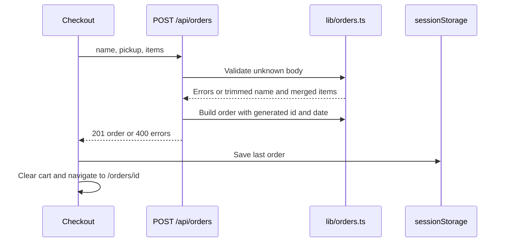

# Checkout

Active contributors: nicolasschmidt2001 (Nicolas Schmidt)

## Purpose

Checkout collects a pickup name and time, posts cart quantities, and shows a server-priced mock order. Nothing is charged, reserved, or saved to a server-side order store (`components/Checkout.tsx`, `app/api/orders/route.ts`).

## Layout and abstractions

`app/checkout/page.tsx` renders `components/Checkout.tsx`. The component waits for cart hydration, shows a browse-menu link for an empty cart, and otherwise displays the form and `components/OrderLines.tsx` summary.

`lib/orders.ts` defines `OrderRequest`, `Order`, the validation union, and five pickup ids: `asap`, `in-15`, `in-30`, `in-45`, and `in-60`. These are fixed labels, not live scheduling availability. `buildOrder` receives an id and Date from the caller, calculates lines and total using the catalog, and emits an ISO placement timestamp.

## Request and confirmation flow

`components/Checkout.tsx` disables the submit button while submitting. Rejected requests display returned errors; fetch or JSON-processing failures display a connection/retry message. Failure keeps the cart. Success tracks order facts, saves the response, clears the cart, and navigates.

`app/api/orders/route.ts` rejects malformed JSON, calls validation, and creates an id in the form `BB-` plus six uppercase UUID characters. It returns 201 for a placed order or 400 with an errors array for invalid input. `withTelemetry` handles unexpected exceptions; see the [API contract](../api/index.md) and [Monitoring](../how-to-monitor/index.md).

## Validation boundaries

`validateOrderRequest` in `lib/orders.ts` requires a nonblank string name of at most 60 characters after trimming, a known pickup id, and a nonempty array of known products with integer quantities from 1 through 99.

The 99-unit limit is checked **per raw input line before merging**. Two valid lines for the same product can merge into a quantity above 99; there is no second merged-quantity cap. Duplicate merging also lets repeated lines reach the bulk-discount threshold before server pricing.

The API accepts no authoritative browser total. `buildOrder` uses `priceLines` and `calculateCartTotal` without a promo code. The empty promotion registry is not an enabled checkout feature (`lib/orders.ts`, `lib/promotions.ts`).

## Tab-local receipt

`components/lastOrder.ts` saves only one order under `bean-and-byte:last-order` in sessionStorage. Storage and parse failures are caught; loaded JSON is cast to `Order`, not schema-validated.

`app/orders/[id]/page.tsx` passes the URL id to `components/OrderConfirmation.tsx`, which loads that one saved order and requires its id to match. Missing or replaced data shows “Order not found.” There is no order GET endpoint or server receipt lookup; the page cannot recover an older order from its URL alone. If storage is unavailable, placement can succeed and clear the cart but confirmation will be missing.

`components/OrderLines.tsx` displays returned cents but resolves product names from the current catalog. The order is a local demo receipt, not a durable financial record.

## Integration and modification points

Add request fields in `lib/orders.ts`, validate them there, and wire them through `components/Checkout.tsx` and `app/api/orders/route.ts`. Keep pricing in the shared [Pricing](pricing.md) core. Extending pickup ids requires updating both the union and `PICKUP_SLOTS` in `lib/orders.ts`.

Keep the pickup name out of events and logs. `lib/analytics.ts` produces name-free order properties, and `app/api/orders/route.ts` logs selected order facts rather than the request body.

## Scope and measurements

The table defines eight source files and one dedicated unit-test file: test/code file-count ratio 1/8 (0.125). Imported cart, pricing, analytics, logger, and telemetry modules and the shared `e2e/storefront.spec.ts` are excluded. This is a file ratio, not coverage.

`git log origin/main` over these nine paths has one unique human author, Nicolas Schmidt, after excluding `[bot]` accounts and deduplicating identities. `.github/CODEOWNERS` assigns the same person as nicolasschmidt2001.

## Key source files

| Repo-root path | Role |
| --- | --- |
| `app/checkout/page.tsx` | Checkout route |
| `app/orders/[id]/page.tsx` | Confirmation route |
| `app/api/orders/route.ts` | JSON boundary, id generation, pricing, and response |
| `lib/orders.ts` | Request validation, merge, pickup labels, and order assembly |
| `components/Checkout.tsx` | Form, fetch, error state, and completion actions |
| `components/OrderLines.tsx` | Shared read-only line display |
| `components/OrderConfirmation.tsx` | Matching tab-local receipt or missing state |
| `components/lastOrder.ts` | Session storage helper |
| `tests/orders.test.ts` | Validation, duplicate merge, order totals, and pickup labels |

`e2e/storefront.spec.ts` covers the happy-path receipt and API repricing/rejection. See [Testing](../how-to-contribute/testing.md) for checks.
