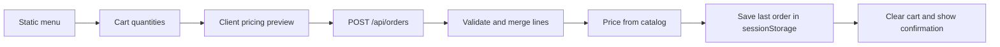

# Storefront features

Active contributors: nicolasschmidt2001 (Nicolas Schmidt)

## Purpose

Bean & Byte lets a visitor browse a static menu, maintain a cart, and place a mock pickup order. The feature pages trace those interactions from React to the pure TypeScript rules and the order endpoint (`app/layout.tsx`, `lib/orders.ts`).

## Feature map

| Feature | Main abstraction | Read next |
| --- | --- | --- |
| Menu browsing | Static products and categories rendered as cards | [Catalog](catalog.md) |
| Saved quantities | Shared cart context and localStorage | [Cart](cart.md) |
| Bulk discounts | Pure line pricing and cart totals in cents | [Pricing](pricing.md) |
| Pickup order | Validated request, server-priced order, tab-local receipt | [Checkout](checkout.md) |
| Product events and flags | Typed property builders and optional PostHog client | [Analytics](analytics.md) |

`app/layout.tsx` mounts the shared provider, header, drawer, and analytics loader around every route. `app/page.tsx`, `app/checkout/page.tsx`, and `app/orders/[id]/page.tsx` select the menu, checkout, and confirmation screens. See [Architecture](../overview/architecture.md) for runtime boundaries and [Data models](../reference/data-models.md) for the shared types.

## End-to-end flow

`components/ProductCard.tsx` adds quantities, `components/Checkout.tsx` posts only name, pickup, and items, and `app/api/orders/route.ts` calculates the returned total through `lib/orders.ts`. No payment or server-side order persistence is implemented.

## Integration and change boundaries

Keep business rules in `lib/`, browser state in `components/`, and server I/O outside the pure core (`AGENTS.md`). A new price rule belongs in `lib/pricing.ts`; a new request field needs matching validation in `lib/orders.ts` and UI handling in `components/Checkout.tsx`. The [API contract](../api/index.md) is the HTTP reference.

The promotion registry in `lib/promotions.ts` is empty and is not wired into checkout. Analytics is optional and its flag-off behavior must leave the main purchase flow usable (`components/posthog.ts`). Operational telemetry is documented under [Monitoring](../how-to-monitor/index.md), not as a purchase dependency.

## Scope and measurements

The five domain pages enumerate 26 distinct source files and five dedicated unit-test files. Their aggregate test/code **file-count ratio** is 5/26 (0.19). Counts include only the source and test rows in those pages' key-file tables; shared integration files such as `app/layout.tsx`, CSS, photos, server telemetry, and the shared `e2e/storefront.spec.ts` are excluded. These are documentation scopes, not exclusive ownership boundaries or coverage percentages.

Each domain's `git log origin/main -- <listed source and test paths>` has one unique human author, Nicolas Schmidt. Identity is deduplicated by person rather than email; bot names ending in `[bot]` are excluded. `.github/CODEOWNERS` assigns all files to nicolasschmidt2001, the same person, so the byline does not list that identity twice.

## Key source files

| Repo-root path | Role |
| --- | --- |
| `app/layout.tsx` | Shared UI and state composition |
| `lib/products.ts` | Catalog used by rendering and pricing |
| `lib/cart.ts` | Quantity operations and saved-cart parsing |
| `lib/pricing.ts` | Line and total calculations |
| `lib/orders.ts` | Validation and order assembly |
| `lib/analytics.ts` | Event names, flags, and safe property builders |
| `e2e/storefront.spec.ts` | Shared browser and HTTP checks |

For check commands and test boundaries, see [Testing](../how-to-contribute/testing.md).
