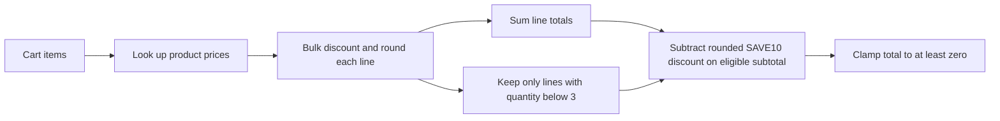

# Pricing

Active contributors: nicolasschmidt2001 (Nicolas Schmidt)

## Purpose

The pure pricing core calculates cart lines and totals in cents for both browser previews and server-created orders. Buying at least three of one item gives that line 10% off. The live SAVE10 promotion takes 10% off eligible non-bulk lines without discounting bulk lines again (`lib/pricing.ts`, `lib/promotions.ts`).

## Layout and abstractions

`calculateLineTotal` in `lib/pricing.ts` returns zero for nonpositive quantities. Below `BULK_DISCOUNT_THRESHOLD` (3), it returns price times quantity. At or above the threshold, it applies `BULK_DISCOUNT_RATE` (0.1) to the gross line amount and uses `Math.round` once for the whole line.

Inputs and outputs are cents, but the discount calculation uses fractional multiplication before rounding. Do not describe the implementation as integer-only arithmetic. For example, three Espressos have a gross of 885 cents and a rounded discounted line of 797 cents (`lib/products.ts`, `lib/pricing.ts`).

`priceLines` resolves each product through the catalog, skips unknown products and nonpositive quantities, and produces `PricedLine` objects containing bulk-only line totals. It does not validate integer quantities or merge duplicate products. `calculateCartTotal` sums those line totals, then optionally subtracts a promotion and clamps the result at zero.

`lib/currency.ts` is the display boundary: `formatCurrency` converts cents to an en-US USD string. Shared shapes are documented in [Data models](../reference/data-models.md).

## Pricing flow and examples

Three Drip Coffees cost 945 cents; adding one Espresso produces 1240 cents. Discounts are per line, not based on the overall item count (`lib/pricing.ts`, `tests/orders.test.ts`). Duplicate raw lines may therefore price differently until normalized: order validation merges them first, while `priceLines` alone does not (`lib/orders.ts`).

## SAVE10 and the promotion registry

`lib/promotions.ts` defines a promotion as a code, description, and `discountCents` function. `findPromotion` trims whitespace and uppercases the input, so ` save10 ` matches `SAVE10`. Unknown codes leave the subtotal unchanged in `calculateCartTotal`; the cart form and order validator enforce known codes separately.

`PROMOTIONS` contains the live `SAVE10` entry. After pricing all valid lines, `calculateCartTotal` filters them to `quantity < BULK_DISCOUNT_THRESHOLD` before calling `discountCents`. SAVE10 sums only those eligible `lineTotalCents`, computes `Math.round(eligibleSubtotal * 0.1)` once, then the caller subtracts that discount from the full subtotal and applies `Math.max(0, total)`. It does not round a reduced price for each eligible line and never discounts a bulk-priced line again.

| Cart | Before SAVE10 (cents) | Promo discount (cents) | Final total (cents) |
| --- | --- | --- | --- |
| One Espresso | 295 | 30 | 265 |
| Two Espressos | 590 | 59 | 531 |
| Three Espressos | 797 | 0 | 797 |
| Three Drip Coffees and one Espresso | 1240 | 30 | 1210 |
| Empty cart | 0 | 0 | 0 |

One Espresso illustrates the rounding boundary: the discount is `Math.round(29.5) = 30`, so the total is 265, not the 266 obtained by rounding `295 * 0.9`. Three Espressos instead use the bulk rule, which rounds the discounted line to 797 (`tests/pricing.test.ts`).

Duplicate normalization belongs to `validateOrderRequest` in `lib/orders.ts`, not the pricing functions. Raw Espresso lines of one and two merge to three before server pricing, producing a bulk-only 797-cent total even with SAVE10 (`tests/orders.test.ts`). Calling `calculateCartTotal` on unmerged lines does not provide that normalization.

`components/CartDrawer.tsx` accepts the code, `components/CartProvider.tsx` keeps it in memory, and `components/Checkout.tsx` sends optional `promoCode` with the request. `buildOrder` passes the validated code to `calculateCartTotal`. `priceLines` remains unchanged by promo codes: displayed line sums can exceed the final promo-adjusted total, and `components/OrderLines.tsx` has no separate promo-discount row. See [Cart](cart.md) for code lifecycle and [Checkout](checkout.md) for validation.

## Integration and modification points

Update rules in `lib/pricing.ts` rather than duplicating calculations in `components/CartDrawer.tsx` or `components/Checkout.tsx`. The server calls the same core from `lib/orders.ts` and does not trust a browser-supplied total.

Changing the discount rate also requires checking the literal “10% off” copy in `components/Storefront.tsx`, `components/CartDrawer.tsx`, and `components/OrderLines.tsx`. Update threshold, rounding, and mixed-cart expectations in `tests/pricing.test.ts`, order expectations in `tests/orders.test.ts`, and the shared browser checks in `e2e/storefront.spec.ts`. See [Checkout](checkout.md) for the server boundary.

## Scope and measurements

The table defines three source files and one dedicated test file. The test/code file-count ratio is 1/3 (0.33), not coverage. Catalog/types, UI consumers, order tests, and shared E2E checks are excluded from this narrow pricing scope.

`git log origin/main` across these four paths has one unique human contributor, Nicolas Schmidt, after excluding `[bot]` accounts and deduplicating identities. The official owner in `.github/CODEOWNERS` is nicolasschmidt2001, the same person.

## Key source files

| Repo-root path | Role |
| --- | --- |
| `lib/pricing.ts` | Bulk rules, priced lines, and cart totals |
| `lib/promotions.ts` | Live SAVE10 discount and normalized lookup |
| `lib/currency.ts` | USD formatting |
| `tests/pricing.test.ts` | Bulk and promo thresholds, mixed lines, rounding, code matching, skipped inputs, and formatting |
