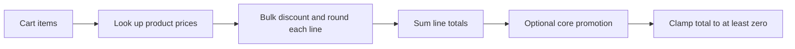

# Pricing

Active contributors: nicolasschmidt2001 (Nicolas Schmidt)

## Purpose

The pure pricing core calculates cart lines and totals in cents for both browser previews and server-created orders. Buying at least three of one item gives that line 10% off (`lib/pricing.ts`).

## Layout and abstractions

`calculateLineTotal` in `lib/pricing.ts` returns zero for nonpositive quantities. Below `BULK_DISCOUNT_THRESHOLD` (3), it returns price times quantity. At or above the threshold, it applies `BULK_DISCOUNT_RATE` (0.1) to the gross line amount and uses `Math.round` once for the whole line.

Inputs and outputs are cents, but the discount calculation uses fractional multiplication before rounding. Do not describe the implementation as integer-only arithmetic. For example, three Espressos have a gross of 885 cents and a rounded discounted line of 797 cents (`lib/products.ts`, `lib/pricing.ts`).

`priceLines` resolves each product through the catalog, skips unknown products and nonpositive quantities, and produces `PricedLine` objects. It does not validate integer quantities or merge duplicate products. `calculateCartTotal` sums those line totals, then optionally subtracts a promotion and clamps the result at zero.

`lib/currency.ts` is the display boundary: `formatCurrency` converts cents to an en-US USD string. Shared shapes are documented in [Data models](../reference/data-models.md).

## Pricing flow and examples

Three Drip Coffees cost 945 cents; adding one Espresso produces 1240 cents. Discounts are per line, not based on the overall item count (`lib/pricing.ts`, `tests/orders.test.ts`). Duplicate raw lines may therefore price differently until normalized: order validation merges them first, while `priceLines` alone does not (`lib/orders.ts`).

## Promotion extension point

`lib/promotions.ts` defines a promotion as a code, description, and `discountCents` function over already bulk-priced lines. Lookup trims whitespace and uppercases the input. Unknown codes leave the subtotal unchanged.

`PROMOTIONS` is empty. Checkout has no promo input, `OrderRequest` has no promo field, and `buildOrder` does not pass a promo code (`components/Checkout.tsx`, `lib/orders.ts`). This is a core extension point, not an enabled checkout feature. Adding registry entries alone would not make codes redeemable through the current UI or API.

## Integration and modification points

Update rules in `lib/pricing.ts` rather than duplicating calculations in `components/CartDrawer.tsx` or `components/Checkout.tsx`. The server calls the same core from `lib/orders.ts` and does not trust a browser-supplied total.

Changing the discount rate also requires checking the literal “10% off” copy in `components/Storefront.tsx`, `components/CartDrawer.tsx`, and `components/OrderLines.tsx`. Update threshold, rounding, and mixed-cart expectations in `tests/pricing.test.ts`, order expectations in `tests/orders.test.ts`, and the shared browser checks in `e2e/storefront.spec.ts`. See [Checkout](checkout.md) for the server boundary.

## Scope and measurements

The table defines three source files and one dedicated test file. The test/code file-count ratio is 1/3 (0.33), not coverage. Catalog/types, UI consumers, order tests, and shared E2E checks are excluded from this narrow pricing scope.

`git log origin/main` across these four paths has one unique human contributor, Nicolas Schmidt, after excluding `[bot]` accounts and deduplicating identities. The official owner in `.github/CODEOWNERS` is nicolasschmidt2001, the same person.

## Key source files

| Repo-root path | Role |
| --- | --- |
| `lib/pricing.ts` | Bulk rules, priced lines, and cart totals |
| `lib/promotions.ts` | Empty promotion registry and normalized lookup |
| `lib/currency.ts` | USD formatting |
| `tests/pricing.test.ts` | Thresholds, mixed lines, skipped inputs, unknown codes, and formatting |
