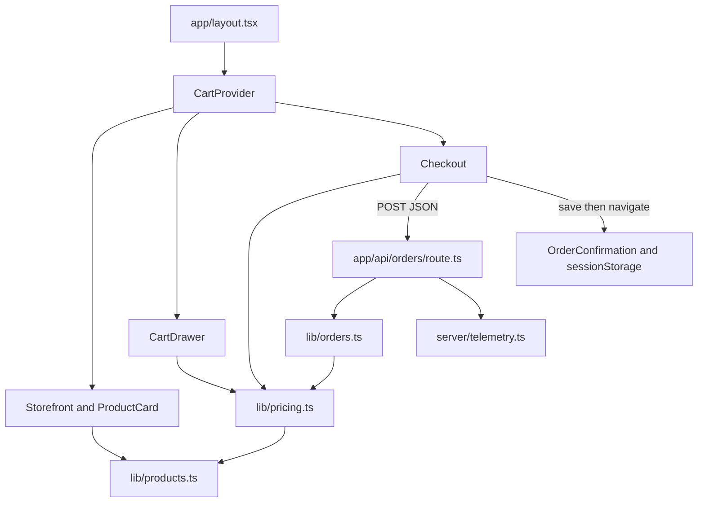
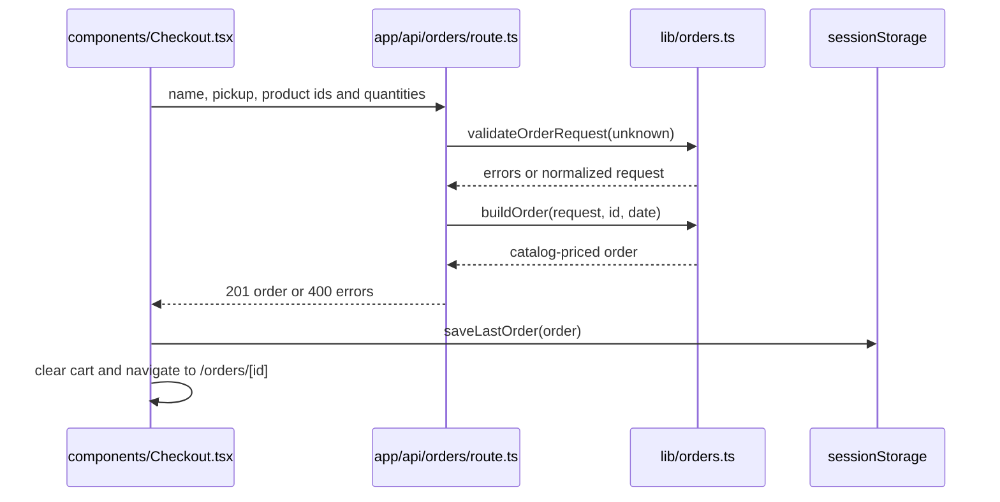

# Architecture

One Next.js application handles the menu, checkout, confirmation, and two API endpoints. Pure business rules live in `lib/`, React code lives in `app/` and `components/`, and server I/O lives in `server/` (`AGENTS.md`, `app/layout.tsx`).

## Component boundaries

`components/CartProvider.tsx` shares quantities across routes and delays localStorage writes until its first read. `lib/cart.ts` supplies immutable quantity operations and validates stored entries. `lib/pricing.ts` calculates cents, and `lib/currency.ts` formats USD only at display boundaries.

The code is primarily TypeScript and TSX, with JavaScript automation scripts and CSS styling. Exact language counts and their collection method are in [By the numbers](../by-the-numbers.md).

## Order lifecycle

`lib/orders.ts` merges duplicate products after validating individual input lines. The 99-unit limit applies to each submitted line, not to the merged quantity. `buildOrder` does not accept a promo code; promo support in `lib/pricing.ts` is not wired into checkout.

## Runtime and telemetry

`instrumentation.ts` loads Node telemetry from `server/instrumentation-node.ts`. OTLP exports require an endpoint, and profiling requires a Pyroscope address. `server/telemetry.ts` wraps routes, captures unexpected exceptions, and schedules flushing with Vercel's `waitUntil`.

Browser analytics load lazily through `components/posthog.ts`. The `menu-announcement` flag stays off until PostHog confirms it. `app/error.tsx` and `app/global-error.tsx` report rendering exceptions when analytics are configured.

## Repository map

| Area | Responsibility | Documentation |
| --- | --- | --- |
| `app/`, `components/` | Routes, UI, browser storage | [Features](../features/index.md) |
| `lib/` | Catalog, cart, pricing, order validation, analytics properties | [Pricing](../features/pricing.md), [Data models](../reference/data-models.md) |
| `server/`, `instrumentation.ts` | Logs, errors, metrics, traces, profiles | [Monitoring](../how-to-monitor/index.md) |
| `scripts/`, `observability/grafana/` | Reporting and external-service automation | [Tooling](../how-to-contribute/tooling.md) |
| `tests/`, `e2e/` | Unit and browser/API checks | [Testing](../how-to-contribute/testing.md) |
| `.github/workflows/` | Checks, review, releases, deploy records, issue sync | [Deployment](../deployment.md) |
| `public/products/` | Catalog photos | [Catalog](../features/catalog.md) |

There are no workspace packages, background order workers, or separate backend service in the current tree. See [API](../api/index.md) for the HTTP boundary.
